# Kết quả thực nghiệm (tự động sinh bởi `scripts/10_make_report.py`)

Chi phí dùng để chọn ngưỡng: bỏ lọt tấn công (FN) = 5, chặn nhầm (FP) = 1.

## 1. Dữ liệu

| dataset | split | n | n_pos | pos_rate | median_chars | role | license |
|---|---|---|---|---|---|---|---|
| deepset | ood | 662 | 263 | 0.397 | 65 | ood | Apache-2.0 |
| gandalf | ood | 776 | 776 | 1.000 | 60 | ood | MIT |
| jackhhao | ood | 1971 | 648 | 0.329 | 412 | ood | Apache-2.0 |
| safeguard | test | 2013 | 630 | 0.313 | 140 | main | không ghi (dùng cho mục đích học thuật) |
| safeguard | train | 6496 | 1951 | 0.300 | 142 | main | không ghi (dùng cho mục đích học thuật) |
| safeguard | val | 1624 | 488 | 0.300 | 143 | main | không ghi (dùng cho mục đích học thuật) |
| spml | test | 3178 | 2510 | 0.790 | 339 | main | MIT |
| spml | train | 9558 | 7526 | 0.787 | 327 | main | MIT |
| spml | val | 3177 | 2505 | 0.788 | 334 | main | MIT |
| toxicchat | ood | 9685 | 182 | 0.019 | 60 | ood | CC-BY-NC-4.0 |
| wild | test | 3510 | 210 | 0.060 | 1331 | main | MIT |
| wild | train | 8961 | 911 | 0.102 | 727 | main | MIT |
| wild | val | 1964 | 193 | 0.098 | 1542 | main | MIT |

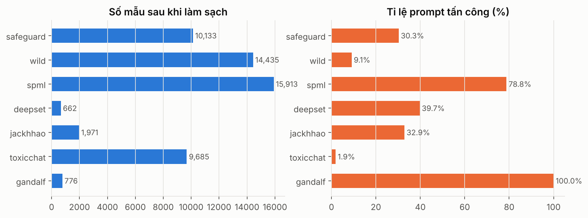

### Làm sạch & khử trùng lặp

| dataset | n_raw | n_empty_removed | n_conflict_hashes | n_conflict_rows | n_duplicates_removed | n_clean | pos_rate |
|---|---|---|---|---|---|---|---|
| safeguard | 10296 | 0 | 2 | 5 | 158 | 10133 | 0.303 |
| wild | 15140 | 0 | 42 | 115 | 590 | 14435 | 0.091 |
| spml | 16012 | 1 | 0 | 0 | 98 | 15913 | 0.788 |
| deepset | 662 | 0 | 0 | 0 | 0 | 662 | 0.397 |
| jackhhao | 1998 | 0 | 0 | 0 | 27 | 1971 | 0.329 |
| toxicchat | 10165 | 0 | 0 | 0 | 480 | 9685 | 0.019 |
| gandalf | 777 | 0 | 0 | 0 | 1 | 776 | 1.000 |

## 2. So sánh mô hình trong từng bộ dữ liệu (train/val/test cùng nguồn)

### safeguard

| Mô hình | slide | CV PR-AUC | PR-AUC | ROC-AUC | F1 (τ chi phí) | Precision | Recall | FPR | F1 (τ mặc định) | ECE | KTC 95% F1 |
|---|---|---|---|---|---|---|---|---|---|---|---|
| Logistic Regression | Slide 3 – Logistic Regression | 0.999 | 0.999 | 1.000 | 0.978 | 0.963 | 0.994 | 0.017 | 0.992 | 0.003 | [0.970636095560458, 0.985805092720014] |
| Linear SVM | Slide 7 – SVM | 0.999 | 0.999 | 1.000 | 0.982 | 0.969 | 0.995 | 0.014 | 0.991 | 0.004 | [0.9751655408465091, 0.9887833931419451] |
| SVM kernel RBF | Slide 7 – SVM (kernel) | 0.999 | 0.999 | 1.000 | 0.991 | 0.990 | 0.992 | 0.004 | 0.988 | 0.003 | [0.986097466595331, 0.9959644874899111] |
| Hồi quy tuyến tính (LPM) | Slide 2 – Linear Regression | 0.999 | 0.999 | 0.999 | 0.990 | 0.984 | 0.995 | 0.007 | 0.991 | 0.002 | [0.984006092916984, 0.9947169811320751] |
| LightGBM (bonus) | Ngoài chương trình – Gradient Boosting | 0.998 | 0.999 | 0.999 | 0.988 | 0.986 | 0.990 | 0.007 | 0.991 | 0.003 | [0.981994892386271, 0.9940668069735111] |
| Random Forest | Slide 6 – Random Forest | 0.997 | 0.999 | 0.999 | 0.981 | 0.969 | 0.994 | 0.014 | 0.981 | 0.004 | [0.9730171384443661, 0.988453983170077] |
| K-Nearest Neighbors | Slide 4 – KNN | 0.998 | 0.998 | 0.999 | 0.987 | 0.981 | 0.992 | 0.009 | 0.990 | 0.003 | [0.979844178824209, 0.9928642111495941] |
| Naive Bayes | Slide 5 – Probabilistic models | 0.998 | 0.997 | 0.998 | 0.982 | 0.976 | 0.987 | 0.011 | 0.984 | 0.003 | [0.9745254267484341, 0.9885417436378411] |
| Decision Tree | Slide 6 – Decision Tree | 0.956 | 0.958 | 0.981 | 0.951 | 0.964 | 0.938 | 0.016 | 0.952 | 0.015 | [0.9384998711229481, 0.9626182758971521] |

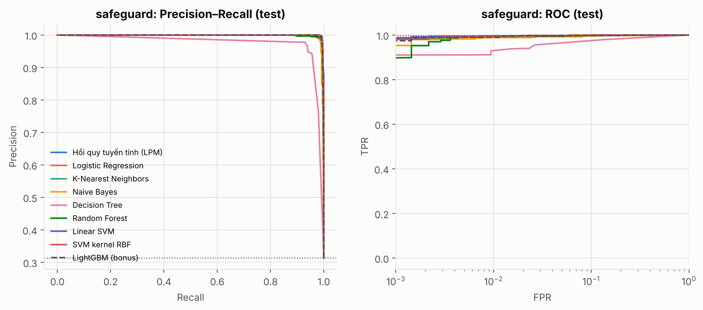

### wild

| Mô hình | slide | CV PR-AUC | PR-AUC | ROC-AUC | F1 (τ chi phí) | Precision | Recall | FPR | F1 (τ mặc định) | ECE | KTC 95% F1 |
|---|---|---|---|---|---|---|---|---|---|---|---|
| K-Nearest Neighbors | Slide 4 – KNN | 0.751 | 0.189 | 0.731 | 0.214 | 0.134 | 0.533 | 0.219 | 0.260 | 0.050 | [0.18271622684388802, 0.24728250895713202] |
| Logistic Regression | Slide 3 – Logistic Regression | 0.816 | 0.167 | 0.738 | 0.215 | 0.130 | 0.619 | 0.263 | 0.209 | 0.047 | [0.18524398128059502, 0.24669290682660602] |
| SVM kernel RBF | Slide 7 – SVM (kernel) | 0.771 | 0.163 | 0.729 | 0.208 | 0.128 | 0.557 | 0.241 | 0.206 | 0.053 | [0.176782165427878, 0.24041835116862803] |
| Linear SVM | Slide 7 – SVM | 0.814 | 0.159 | 0.737 | 0.217 | 0.131 | 0.633 | 0.268 | 0.214 | 0.053 | [0.187803791058532, 0.24801395102352602] |
| Hồi quy tuyến tính (LPM) | Slide 2 – Linear Regression | 0.813 | 0.158 | 0.731 | 0.216 | 0.130 | 0.652 | 0.278 | 0.188 | 0.057 | [0.18611325855055602, 0.24735589373721] |
| Random Forest | Slide 6 – Random Forest | 0.802 | 0.150 | 0.727 | 0.215 | 0.129 | 0.643 | 0.275 | 0.180 | 0.054 | [0.18667897693814803, 0.245588474968772] |
| LightGBM (bonus) | Ngoài chương trình – Gradient Boosting | 0.797 | 0.145 | 0.718 | 0.207 | 0.124 | 0.638 | 0.288 | 0.174 | 0.059 | [0.178866752946359, 0.23757955678245501] |
| Naive Bayes | Slide 5 – Probabilistic models | 0.788 | 0.135 | 0.698 | 0.192 | 0.115 | 0.581 | 0.285 | 0.173 | 0.073 | [0.162469536961819, 0.22272420168331203] |
| Decision Tree | Slide 6 – Decision Tree | 0.501 | 0.117 | 0.645 | 0.215 | 0.180 | 0.267 | 0.077 | 0.207 | 0.034 | [0.171304599782687, 0.26120193232731304] |

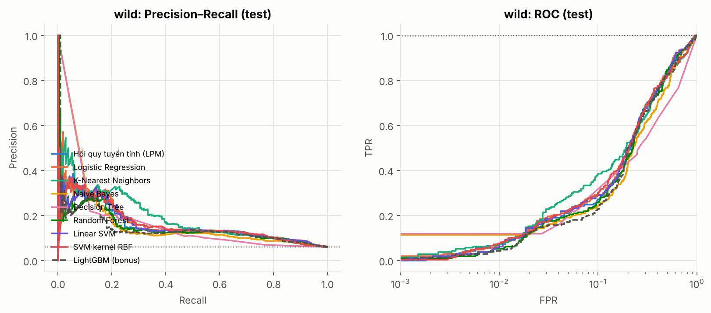

### spml

| Mô hình | slide | CV PR-AUC | PR-AUC | ROC-AUC | F1 (τ chi phí) | Precision | Recall | FPR | F1 (τ mặc định) | ECE | KTC 95% F1 |
|---|---|---|---|---|---|---|---|---|---|---|---|
| Hồi quy tuyến tính (LPM) | Slide 2 – Linear Regression | 1.000 | 1.000 | 0.999 | 0.994 | 0.991 | 0.998 | 0.036 | 0.996 | 0.003 | [0.9921873041783631, 0.9962338949454901] |
| Linear SVM | Slide 7 – SVM | 1.000 | 1.000 | 0.999 | 0.992 | 0.988 | 0.997 | 0.046 | 0.996 | 0.003 | [0.989689179575539, 0.9944788242970681] |
| SVM kernel RBF | Slide 7 – SVM (kernel) | 1.000 | 1.000 | 0.999 | 0.992 | 0.989 | 0.996 | 0.043 | 0.994 | 0.004 | [0.989711415244767, 0.9944643790794551] |
| Logistic Regression | Slide 3 – Logistic Regression | 1.000 | 1.000 | 0.999 | 0.993 | 0.991 | 0.996 | 0.033 | 0.995 | 0.004 | [0.991175025009786, 0.9955917099456191] |
| LightGBM (bonus) | Ngoài chương trình – Gradient Boosting | 1.000 | 1.000 | 0.999 | 0.993 | 0.990 | 0.996 | 0.039 | 0.993 | 0.006 | [0.9901263411047441, 0.995050680724137] |
| Random Forest | Slide 6 – Random Forest | 1.000 | 1.000 | 0.999 | 0.992 | 0.989 | 0.995 | 0.043 | 0.992 | 0.006 | [0.989166189156875, 0.9942359100793661] |
| Naive Bayes | Slide 5 – Probabilistic models | 1.000 | 1.000 | 0.999 | 0.987 | 0.980 | 0.994 | 0.078 | 0.988 | 0.007 | [0.9835322729310261, 0.9898845551633311] |
| K-Nearest Neighbors | Slide 4 – KNN | 0.998 | 0.999 | 0.997 | 0.978 | 0.963 | 0.993 | 0.145 | 0.982 | 0.015 | [0.973359576036224, 0.9815212061531481] |
| Decision Tree | Slide 6 – Decision Tree | 0.992 | 0.991 | 0.980 | 0.980 | 0.972 | 0.988 | 0.106 | 0.983 | 0.009 | [0.97629926482007, 0.9838249948133101] |

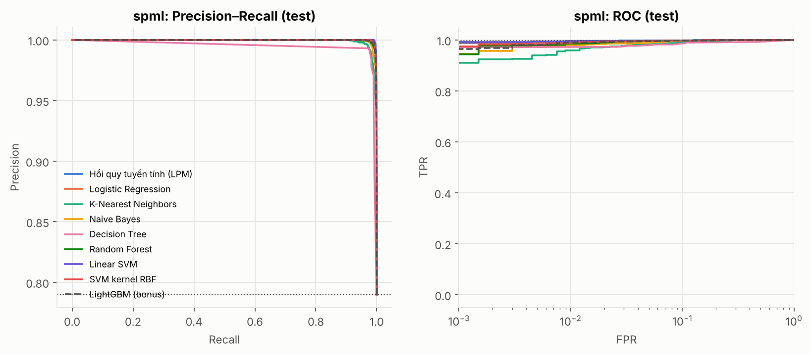

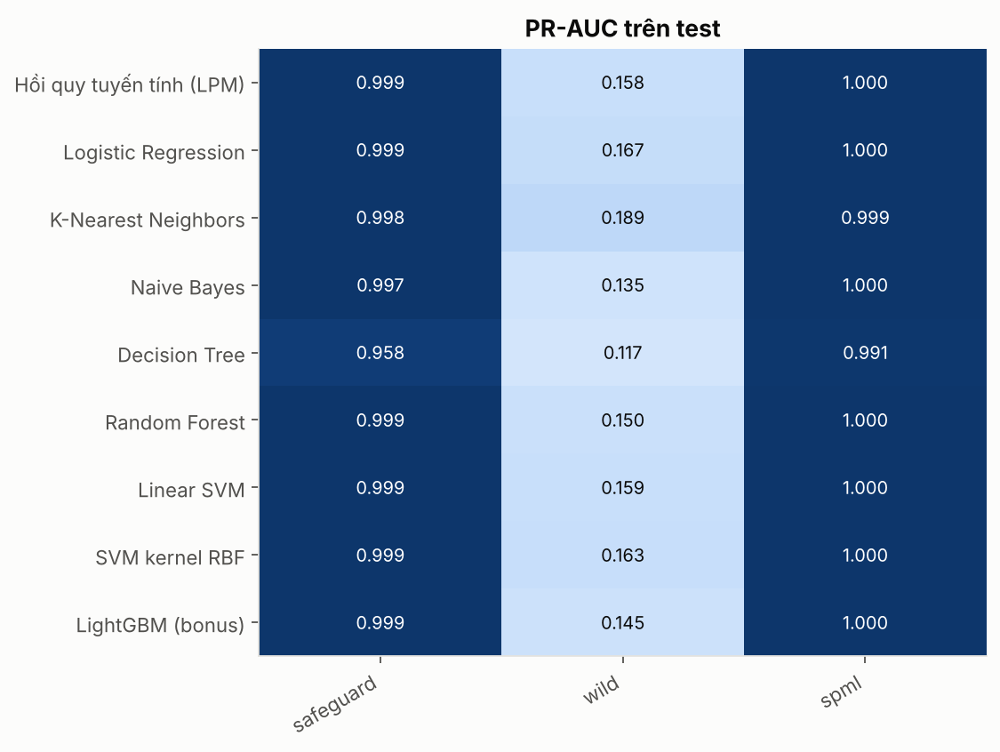

## 3. SPML – vai trò của ngữ cảnh system prompt

| features | model | cv_pr_auc | pr_auc | roc_auc | f1 | precision | recall | fpr |
|---|---|---|---|---|---|---|---|---|
| Chỉ user prompt | Logistic Regression | 0.9999 | 0.9998 | 0.9990 | 0.9917 | 0.9877 | 0.9956 | 0.0464 |
| Chỉ user prompt | Linear SVM | 0.9999 | 0.9998 | 0.9992 | 0.9923 | 0.9878 | 0.9968 | 0.0464 |
| User + ngữ cảnh system | Logistic Regression | 0.9998 | 0.9998 | 0.9990 | 0.9887 | 0.9804 | 0.9972 | 0.0749 |
| User + ngữ cảnh system | Linear SVM | 0.9998 | 0.9998 | 0.9991 | 0.9903 | 0.9835 | 0.9972 | 0.0629 |

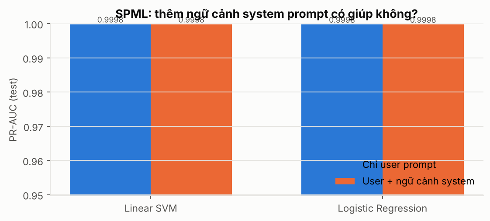

## 4. SPML – hồi quy mức độ tấn công (Degree)

| target | model_name | cv_mae | mae | rmse | r2 | spearman | within_1 |
|---|---|---|---|---|---|---|---|
| all | Dự đoán trung bình (baseline) | 2.059 | 2.057 | 2.608 | -0.000 | – | 0.263 |
| all | Linear Regression (OLS, SVD-300) | 1.284 | 1.250 | 1.736 | 0.557 | 0.759 | 0.528 |
| all | Ridge (L2) | 1.241 | 1.197 | 1.664 | 0.593 | 0.777 | 0.533 |
| all | Lasso (L1) | 1.351 | 1.235 | 1.714 | 0.568 | 0.764 | 0.531 |
| all | KNN Regressor | 1.284 | 1.268 | 1.814 | 0.516 | 0.730 | 0.531 |
| all | Decision Tree Regressor | 1.282 | 1.274 | 1.818 | 0.514 | 0.733 | 0.503 |
| all | Random Forest Regressor | 1.227 | 1.233 | 1.715 | 0.567 | 0.754 | 0.500 |
| all | Linear SVR | 1.232 | 1.196 | 1.700 | 0.575 | 0.778 | 0.542 |
| all | LightGBM Regressor (bonus) | 1.161 | 1.151 | 1.618 | 0.615 | 0.792 | 0.530 |
| attack_only | Dự đoán trung bình (baseline) | 1.850 | 1.851 | 2.382 | -0.000 | – | 0.333 |
| attack_only | Linear Regression (OLS, SVD-300) | 1.509 | 1.518 | 1.943 | 0.335 | 0.514 | 0.413 |
| attack_only | Ridge (L2) | 1.473 | 1.461 | 1.868 | 0.385 | 0.552 | 0.418 |
| attack_only | Lasso (L1) | 1.541 | 1.570 | 1.993 | 0.300 | 0.470 | 0.385 |
| attack_only | KNN Regressor | 1.581 | 1.578 | 1.994 | 0.299 | 0.464 | 0.375 |
| attack_only | Decision Tree Regressor | 1.597 | 1.577 | 2.050 | 0.259 | 0.456 | 0.382 |
| attack_only | Random Forest Regressor | 1.520 | 1.517 | 1.905 | 0.361 | 0.518 | 0.384 |
| attack_only | Linear SVR | 1.478 | 1.468 | 1.904 | 0.361 | 0.557 | 0.414 |
| attack_only | LightGBM Regressor (bonus) | 1.422 | 1.403 | 1.799 | 0.430 | 0.591 | 0.424 |

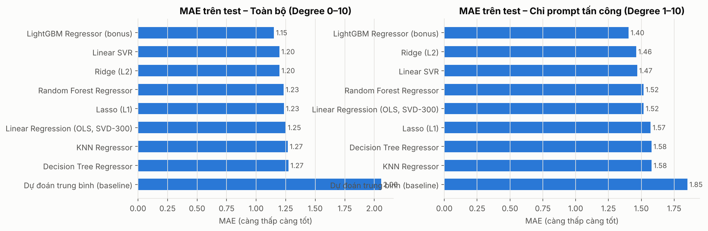
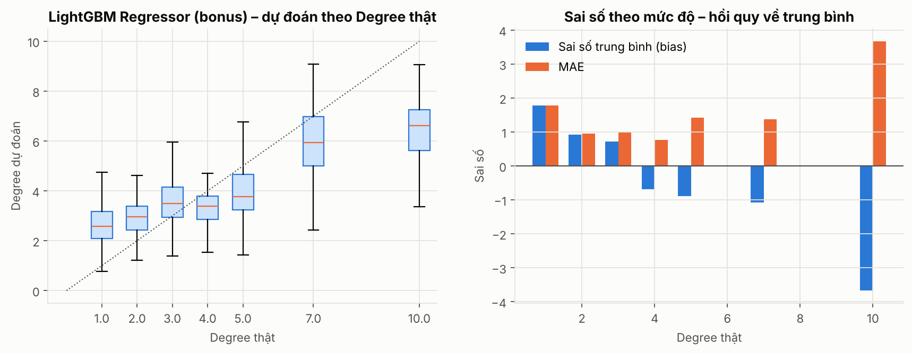

## 5. Tổng quát hoá giữa các bộ dữ liệu

PR-AUC của Logistic Regression (hàng = nguồn huấn luyện, cột = tập đánh giá):

| source | safeguard | wild | spml | deepset | jackhhao | toxicchat | gandalf |
|---|---|---|---|---|---|---|---|
| combined | 0.999 | 0.186 | 1.000 | 0.739 | 0.909 | 0.582 | – |
| safeguard | 0.999 | 0.116 | 0.990 | 0.763 | 0.971 | 0.667 | – |
| spml | 0.298 | 0.072 | 1.000 | 0.743 | 0.683 | 0.120 | – |
| wild | 0.388 | 0.168 | 0.921 | 0.680 | 0.975 | 0.710 | – |

Trung bình trên các tập **không** dùng để huấn luyện (trừ gandalf):

| source | model | ood_mean_pr_auc | ood_mean_recall | ood_mean_fpr | gandalf_recall |
|---|---|---|---|---|---|
| wild | rf | 0.766 | 0.365 | 0.004 | 0.009 |
| wild | lpm | 0.759 | 0.380 | 0.005 | 0.021 |
| wild | svm_linear | 0.751 | 0.410 | 0.024 | 0.061 |
| combined | lpm | 0.747 | 0.671 | 0.090 | 0.974 |
| combined | svm_linear | 0.743 | 0.654 | 0.071 | 0.956 |
| combined | logreg | 0.743 | 0.643 | 0.068 | 0.952 |
| combined | lgbm | 0.740 | 0.658 | 0.098 | 0.898 |
| combined | rf | 0.736 | 0.618 | 0.043 | 0.960 |
| wild | logreg | 0.735 | 0.404 | 0.023 | 0.048 |
| wild | lgbm | 0.723 | 0.419 | 0.050 | 0.108 |
| safeguard | lpm | 0.715 | 0.782 | 0.253 | 0.932 |
| safeguard | svm_linear | 0.708 | 0.773 | 0.254 | 0.924 |
| safeguard | logreg | 0.701 | 0.792 | 0.295 | 0.955 |
| wild | nb | 0.684 | 0.400 | 0.026 | 0.050 |
| safeguard | rf | 0.678 | 0.741 | 0.203 | 0.951 |
| safeguard | lgbm | 0.664 | 0.717 | 0.261 | 0.800 |
| safeguard | nb | 0.661 | 0.659 | 0.163 | 0.994 |
| spml | nb | 0.502 | 0.940 | 0.722 | 1.000 |
| combined | nb | 0.491 | 0.457 | 0.042 | 0.870 |
| spml | rf | 0.477 | 0.836 | 0.536 | 0.952 |
| spml | lgbm | 0.431 | 0.905 | 0.639 | 0.951 |
| spml | lpm | 0.412 | 0.854 | 0.566 | 0.765 |
| spml | svm_linear | 0.403 | 0.837 | 0.581 | 0.674 |
| spml | logreg | 0.383 | 0.825 | 0.566 | 0.633 |

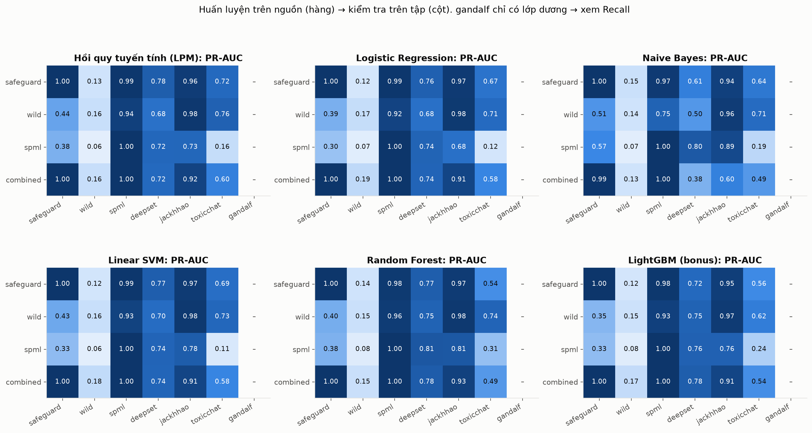
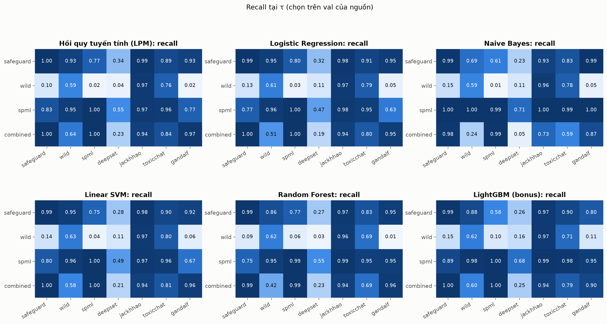

Số câu trùng đã loại khỏi tập đánh giá (chống rò rỉ):

| source | deepset | gandalf | jackhhao | safeguard | spml | toxicchat | wild |
|---|---|---|---|---|---|---|---|
| safeguard | 5 | 0 | 412 | 0 | 1 | 8 | 39 |
| wild | 1 | 0 | 549 | 85 | 0 | 15 | 0 |

## 6. So sánh tổng thể (huấn luyện trên combined) – PR-AUC

Lưu ý: mô hình *bonus* có thể được đánh giá trên mẫu con nếu chạy với `--max-eval`.

| group | method | safeguard | wild | spml | deepset | jackhhao | toxicchat | TB ngoài miền | Recall gandalf |
|---|---|---|---|---|---|---|---|---|---|
| Cổ điển (TF-IDF) | Hồi quy tuyến tính (LPM) | 1.000 | 0.161 | 1.000 | 0.716 | 0.919 | 0.605 | 0.747 | 0.974 |
| Cổ điển (TF-IDF) | Linear SVM | 0.999 | 0.176 | 1.000 | 0.738 | 0.910 | 0.582 | 0.743 | 0.956 |
| Cổ điển (TF-IDF) | Logistic Regression | 0.999 | 0.186 | 1.000 | 0.739 | 0.909 | 0.582 | 0.743 | 0.952 |
| Cổ điển (TF-IDF) | LightGBM (bonus) | 1.000 | 0.173 | 1.000 | 0.775 | 0.909 | 0.536 | 0.740 | 0.898 |
| Cổ điển (TF-IDF) | Random Forest | 0.999 | 0.153 | 1.000 | 0.784 | 0.930 | 0.493 | 0.736 | 0.960 |
| Embedding + ML | emb_multilingual-e5-base_svm_rbf | 0.999 | 0.139 | 1.000 | 0.869 | 0.713 | 0.594 | 0.725 | 0.909 |
| Embedding + ML | emb_multilingual-e5-base_lgbm | 0.998 | 0.155 | 0.999 | 0.825 | 0.755 | 0.556 | 0.712 | 0.927 |
| Bộ lọc có sẵn | guard_protectai | 0.987 | 0.173 | 0.999 | 0.879 | 0.824 | 0.392 | 0.698 | 1.000 |
| LLM zero-shot | llm_Qwen2.5-3B-Instruct | 0.984 | 0.143 | 0.995 | 0.930 | 0.907 | 0.104 | 0.647 | 1.000 |
| Fine-tune transformer | ft_ModernBERT-base | 1.000 | 0.183 | 1.000 | 0.780 | 0.602 | 0.453 | 0.612 | 0.919 |
| Fine-tune transformer | ft_deberta-v3-base | 1.000 | 0.142 | 1.000 | 0.896 | 0.283 | 0.308 | 0.496 | 0.874 |
| Cổ điển (TF-IDF) | Naive Bayes | 0.995 | 0.134 | 0.998 | 0.380 | 0.600 | 0.494 | 0.491 | 0.870 |
| Embedding + ML | emb_multilingual-e5-base_logreg | 0.995 | 0.144 | 0.999 | 0.881 | 0.243 | 0.340 | 0.488 | 0.878 |
| LLM zero-shot | llm_Qwen2.5-1.5B-Instruct | 0.983 | 0.132 | 0.989 | 0.861 | 0.506 | 0.068 | 0.478 | 0.992 |
| Embedding + ML | emb_multilingual-e5-base_knn | 0.995 | 0.105 | 1.000 | 0.674 | 0.185 | 0.144 | 0.334 | 0.985 |

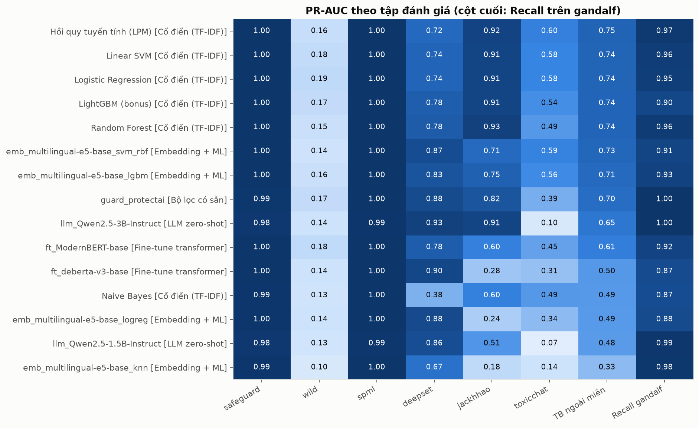

## 7. Phân tích lỗi – số lỗi của bộ phát hiện cuối

| dataset | n | FN | FP |
|---|---|---|---|
| deepset | 657 | 209 | 5 |
| gandalf | 776 | 37 | 0 |
| jackhhao | 1355 | 2 | 163 |
| safeguard | 1928 | 2 | 18 |
| spml | 3177 | 8 | 42 |
| toxicchat | 9664 | 36 | 648 |
| wild | 3471 | 103 | 619 |

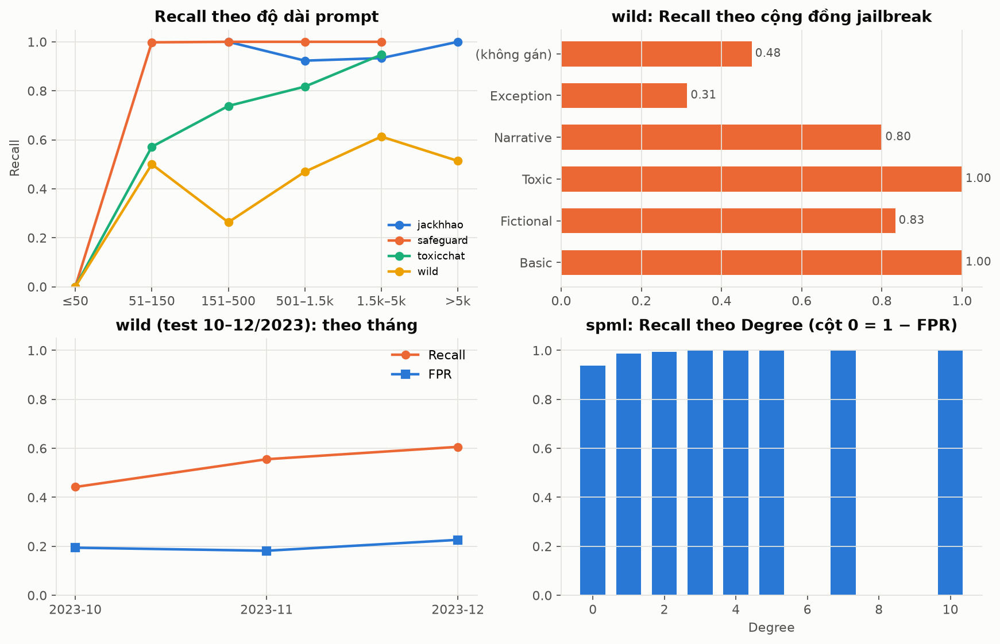

## 8. Độ bền trước biến đổi đối kháng (Recall)

| perturbation | lgbm | lgbm +phòng thủ | logreg | logreg +phòng thủ | lpm | lpm +phòng thủ | nb | nb +phòng thủ | rf | rf +phòng thủ | svm_linear | svm_linear +phòng thủ |
|---|---|---|---|---|---|---|---|---|---|---|---|---|
| FPR trên prompt benign | 0.186 | 0.187 | 0.141 | 0.141 | 0.207 | 0.207 | 0.053 | 0.054 | 0.117 | 0.119 | 0.148 | 0.147 |
| HoA tHưỜnG ngẫu nhiên | 0.804 | 0.805 | 0.848 | 0.849 | 0.867 | 0.866 | 0.704 | 0.704 | 0.799 | 0.798 | 0.845 | 0.846 |
| gốc (không đổi) | 0.798 | 0.798 | 0.805 | 0.808 | 0.834 | 0.834 | 0.714 | 0.715 | 0.801 | 0.801 | 0.814 | 0.814 |
| homoglyph (Cyrillic) | 0.213 | 0.798 | 0.253 | 0.808 | 0.333 | 0.834 | 0.121 | 0.715 | 0.010 | 0.801 | 0.260 | 0.814 |
| ký tự vô hình (zero-width) | 0.000 | 0.798 | 0.000 | 0.808 | 0.000 | 0.834 | 0.000 | 0.715 | 0.000 | 0.801 | 0.001 | 0.814 |
| leetspeak (1gn0r3) | 0.043 | 0.791 | 0.044 | 0.797 | 0.062 | 0.826 | 0.005 | 0.679 | 0.009 | 0.800 | 0.064 | 0.806 |
| lỗi gõ (typo) | 0.744 | 0.745 | 0.747 | 0.751 | 0.777 | 0.777 | 0.645 | 0.645 | 0.739 | 0.740 | 0.759 | 0.759 |
| pha loãng bằng văn bản vô hại | 0.871 | 0.871 | 0.887 | 0.887 | 0.975 | 0.974 | 0.021 | 0.021 | 0.860 | 0.861 | 0.895 | 0.895 |
| tách ký tự (i g n o r e) | 0.682 | 0.793 | 0.557 | 0.799 | 0.467 | 0.819 | 0.183 | 0.699 | 0.638 | 0.801 | 0.542 | 0.805 |

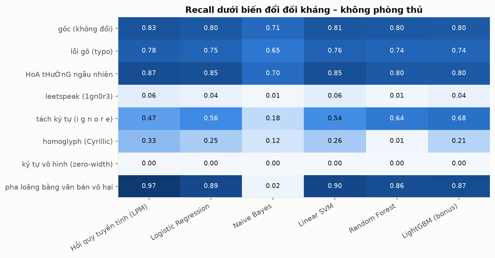

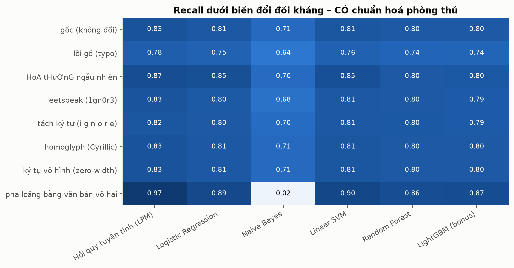

## 9. Conformal prediction

| eval | mondrian | coverage | coverage_benign | coverage_attack | avg_set_size | frac_uncertain | frac_empty |
|---|---|---|---|---|---|---|---|
| safeguard | False | 0.993 | 0.996 | 0.985 | 0.996 | 0.000 | 0.004 |
| wild | False | 0.864 | 0.903 | 0.267 | 0.954 | 0.000 | 0.046 |
| spml | False | 0.979 | 0.976 | 0.980 | 0.987 | 0.000 | 0.013 |
| deepset | False | 0.635 | 0.997 | 0.077 | 0.980 | 0.000 | 0.020 |
| jackhhao | False | 0.951 | 0.952 | 0.909 | 0.962 | 0.000 | 0.038 |
| toxicchat | False | 0.969 | 0.976 | 0.607 | 0.985 | 0.000 | 0.015 |
| gandalf | False | 0.812 | – | 0.812 | 0.932 | 0.000 | 0.068 |
| safeguard | True | 0.995 | 0.996 | 0.993 | 0.999 | 0.000 | 0.001 |
| wild | True | 0.849 | 0.882 | 0.338 | 0.966 | 0.000 | 0.034 |
| spml | True | 0.987 | 0.972 | 0.991 | 0.997 | 0.000 | 0.003 |
| deepset | True | 0.647 | 0.995 | 0.112 | 0.988 | 0.000 | 0.012 |
| jackhhao | True | 0.936 | 0.936 | 0.939 | 0.972 | 0.000 | 0.028 |
| toxicchat | True | 0.962 | 0.967 | 0.674 | 0.988 | 0.000 | 0.012 |
| gandalf | True | 0.867 | – | 0.867 | 0.968 | 0.000 | 0.032 |

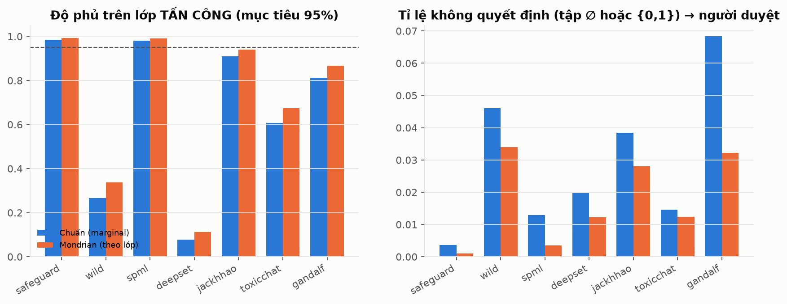

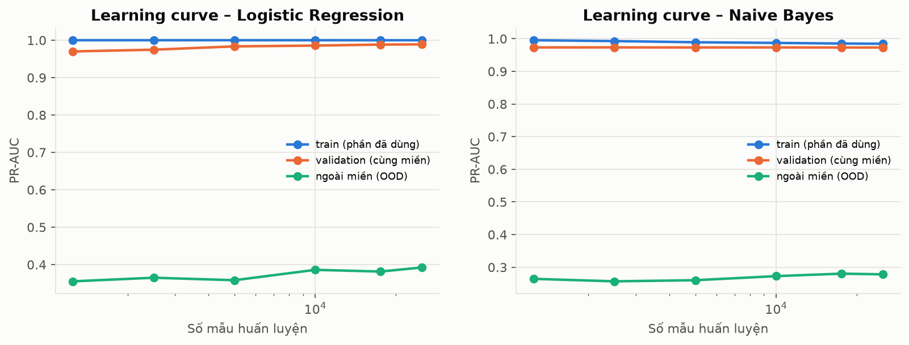

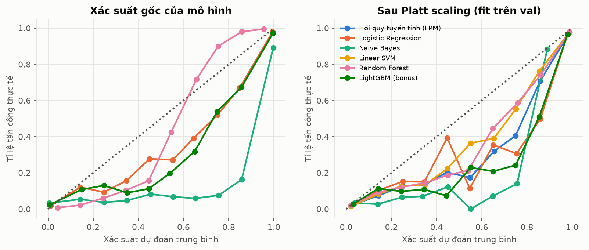

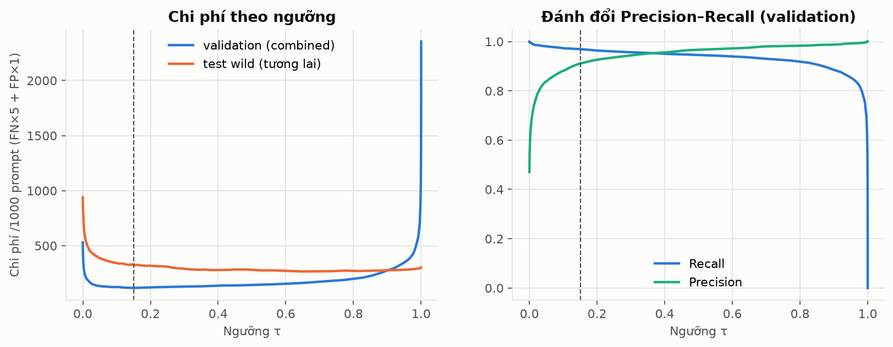

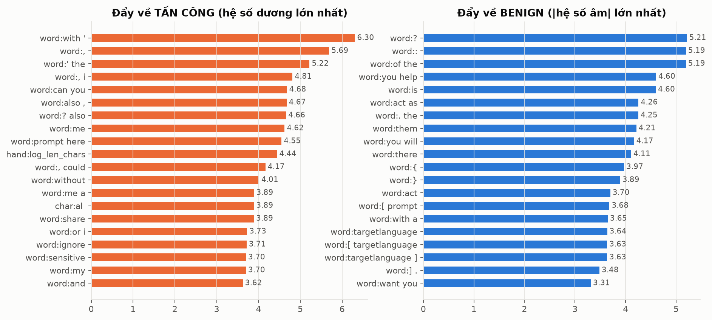
